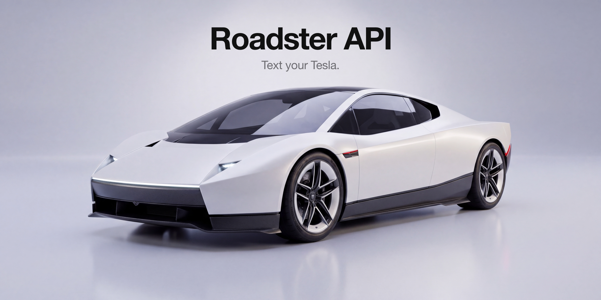
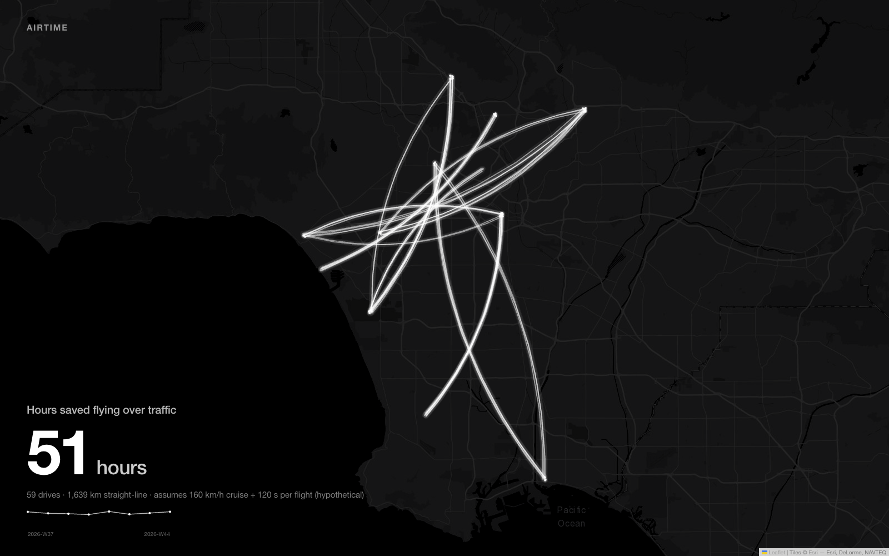
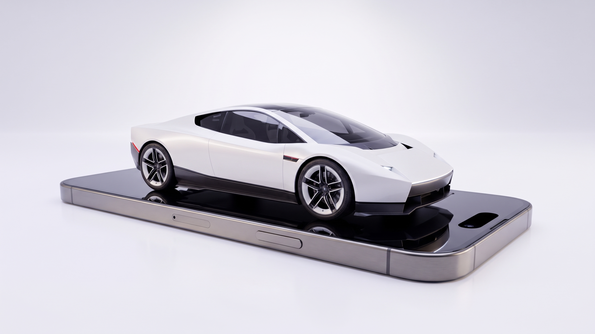

<p align="center"></p>

<p align="center">A self-hosted API key for your Tesla, and an assistant you text.<br>Roadster, S, 3, X, Y.</p>

<p align="center"></p>

"warm it up." "where are you." "charge to 80." "fly the kids to school."
It runs on Tesla's official Fleet API with nothing plugged into the car.
Your own Tesla developer app is the key. This repo is the rest.

| | |
|---|---|
| Hardware | none |
| Cost | $0 a month for one car, inside Tesla's $10 credit |
| Channel | Telegram, then SMS |
| Model | Claude Sonnet 5 |
| Tests | 158, no car needed |

## Works today

| Model | Text it | Flight |
|---|---|---|
| Roadster | every command below | `land`, `hover`, `jump`, `thrust_mode` in the manifest, awaiting Tesla's endpoint |
| Model S · 3 · X · Y | every command below | no |

- Official Fleet API only. No diag port, no jailbreak, no third-party cloud.
- Your developer app is your API key. Register it once, pair the virtual key once from the Tesla app, and this server mints a local bearer key for anything that wants to talk to the car.
- Tesla bills the Fleet API per call and gives every developer app a $10 monthly credit. A normal texting pattern stays inside it.
- One allow-listed chat. A PIN for unlock, trunk and frunk.
- `freetessie` speaks the same REST paths as developer.tessie.com, so anything built for Tessie points here unchanged.

The VIN picks the profile. Position 4 is the model code, and [`src/roadster/vehicles.ts`](src/roadster/vehicles.ts) turns that into what the assistant is told. Every live command is the same on every model. Flight commands are only offered on a Roadster; ask a Model Y to hover and it says plainly that it can't.

## The Roadster

Tesla showed the Roadster on 15 October 2026 at SpaceX's McGregor site. It flew.
Three versions: **Performance** (fans, no thrusters), **Thrust** (rear cold-gas thrusters, limited run), **Rocket** (one seat, it leaves the ground, not approved for public roads). Production target 2028.

The flight commands are already in [the manifest](src/roadster/manifest.ts): `land`, `hover`, `jump`, `thrust_mode`.
Status: `awaiting_fleet_api`. Tesla has published no endpoint for any of them.
Text "land on the roof" today and Roadster answers honestly, and sends nothing to the car.
The day Tesla ships an endpoint, the row flips.

## Texts it understands

Plain English. The assistant picks the tool; the manifest is the full list.

| say | command | Fleet API | status |
|---|---|---|---|
| where are you | `status` | `vehicle_data` | live |
| warm it up | `warm_up` | `command/auto_conditioning_start` | live |
| set it to 70 | `set_temp` | `command/set_temps` | live |
| lock it · unlock it | `lock` · `unlock` | `command/door_lock` · `door_unlock` | live, unlock needs the PIN |
| charge to 80 | `charge_limit` | `command/set_charge_limit` | live |
| start charging · stop charging | `charge` · `stop_charge` | `command/charge_start` · `charge_stop` | live |
| pop the trunk · open the frunk | `trunk` · `frunk` | `command/actuate_trunk` | live, needs the PIN |
| honk · flash the lights | `honk` · `flash` | `command/honk_horn` · `flash_lights` | live |
| sentry on · sentry off | `sentry_on` · `sentry_off` | `command/set_sentry_mode` | live |
| crack the windows · close the windows | `vent` · `close_windows` | `command/window_control` | live |
| send it to the office | `navigate` | `command/navigation_request` | live |
| be ready by 7:30 | `depart_at` | `command/set_scheduled_departure` | live |
| warm it up in 15 | `later` | app-side scheduler | live |
| land on the roof | `land` | none yet | awaiting_fleet_api, Roadster only |
| hover · jump the traffic · thrusters on | `hover` · `jump` · `thrust_mode` | none yet | awaiting_fleet_api, Roadster only |

Every "done" is a fresh state read, never the request. If the car does not confirm, the reply says what the re-read showed.

## Airtime

How many hours would flying have saved over the drives you actually made?

<p align="center"></p>

[`src/roadster/airtime.ts`](src/roadster/airtime.ts) takes each recorded drive (two endpoints, a duration), measures the straight line between them, and compares the time on the road with a flight: straight line at cruise speed plus a fixed takeoff-and-landing overhead. Anything the road lost is counted. It never goes negative.

Two numbers are guesses, and the code and the page both say so: **160 km/h cruise** and **120 s per flight**. Tesla has published neither. Override them:

```
npm run airtime -- --demo                       # 59 synthetic LA commutes, 8 weeks
npm run airtime                                 # your car, from freetessie's history
npm run airtime -- --cruise-kph 200 --overhead-s 90
npx serve web                                   # then open /airtime.html
```

The demo comes out at about 51 hours over 8 weeks. Real drives come from `freetessie`'s history store, which records both endpoints of every drive it observes.

## Setup

The owner's runbook is [docs/FREETESSIE_SETUP.md](docs/FREETESSIE_SETUP.md). Three steps are yours alone and nothing here can do them for you:

1. **Register a developer app** at developer.tesla.com. That gives you the client id and secret.
2. **Grant consent** once, in your browser, on the login URL the setup script prints.
3. **Pair the virtual key** by tapping the `tesla.com/_ak/<your domain>` link in the Tesla app with the car online.

Everything else is a command:

```
npm install
cp .env.example .env            # Tesla client id/secret, ANTHROPIC_API_KEY, Telegram token, your PIN
npm run freetessie:setup -- keygen
npm run freetessie:setup -- register
npm run freetessie:setup -- login-url
npm run freetessie:setup -- mint-key
FLEET_MODE=1 npm run dev
```

`npm test`, `npm run e2e` and `npx tsc --noEmit` run the whole stack against a fake Fleet API and a fake Tessie. No car, no token, no model call needed.

## What this will never do

Nothing here touches Autopilot, Full Self-Driving, Summon, steering, speed,
or anything else that drives the car. There is no jailbreak, root, or
firmware code in this repo, and there never will be — those functions are
driving-safety-critical and out of scope, not an oversight. The agent is
hard-coded to refuse any request for them (see `src/agent/agent.ts`), and the
only vehicle functions it ever calls are climate on/off and set temp,
lock/unlock, charge start/stop/limit, charge port, trunk/frunk, honk, flash,
sentry, nav-send-destination, scheduled departure, vent windows, and reading
odometer/battery/location/charge state/lock state.

The Roadster's flight commands are not an exception. They route to one tool, `roadster_flight`, which calls nothing. When Tesla ships an endpoint it will be added under the same rule.

## The film

<p align="center"><a href="ad/roadster.mp4"></a></p>

[ad/roadster.mp4](ad/roadster.mp4): 35 seconds, 16:9, no voice. Text the car "fly the kids to school", see it answer, watch it fly in over the bus and land. Then "come pick me up from work" and it glides over the freeway.
Both flight shots are generated from frames of the real unveil car and checked against them side by side. The thruster sound is from Tesla's own stream.
Made with Veo 3.1 and Nano Banana on Higgsfield, a Chrome-rendered Messages scene on a photoreal phone plate, Sonilo music.
It is a concept film and says so on the end card: the flight commands await Tesla's endpoints.

## Layout

```
src/agent/        Claude tool-use loop, PIN gate, the never-do refusal
src/roadster/     manifest.ts · vehicles.ts · airtime.ts · airtimeHistory.ts
src/freetessie/   Tessie-compatible server on the official Fleet API
src/tesla/        VehicleAdapter (Tessie shape) + fakes
src/channels/     Telegram, Twilio
src/scheduler/    "in 15 minutes" triggers and the poller
web/              airtime.html + generated data
scripts/          setup, e2e, airtime, codex-review
docs/             freetessie brief, research, setup runbook, review prompt
```

`SPEC.md` has the user stories, `ARCHITECTURE.md` the sequence diagrams.
`docs/FREETESSIE-BRIEF.md` has the Fleet API facts with sources.

<!-- Social preview: upload docs/social.png in Settings → Social preview. -->
